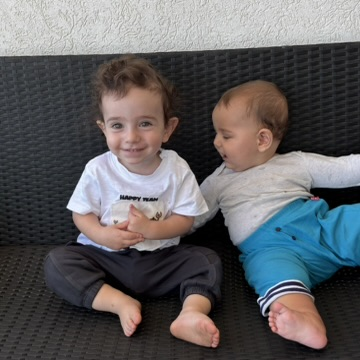

![[Today's Fleeting Notes.base]]

“Wasting” time tweaking obsidian leaves me somewhat empty in the morning. Last Thursday has been the first time in a long time (at work) that I sat for a long period of time, doing meaningful and mind-exerting work. I felt great, though tired (in a good way), on the way back home. There is definitely more [[Flow]] needed in life, and that usually means focusing on projects rather than on simple side quests.

- [ ]  schedule a visit with the family doctor to get a reference to an endocrinologist for the DEXA scan received from project 10k.
- [ ] Moving the money father transferred into the special account.
- [ ] CHALLENGES (sugar, daily minimums …) → insert into vault in some capacity.
- [ ] Issue with continuously linking exercise circuits in daily note.
- [ ] Find a way to externally save vault images.

Met with Dor and Elia today, Yotam and Atalia also came. Was nice with the kids and Idan had a great time. However I left the meeting feeling slightly off. Only later did I manage to pick up on exactly what bothered me. Seeing Dor and Yotam involved in their kids’ lives more than I felt like I am with Idan, both in stories they told and in how they actually were with them. Might only be me but that’s what it was. On top of it all there was the issue of parent preference and I, being  least at home of all dads there, felt bad. There really is a great compromise in the connection that I can establish with Idan to being able to go to work.

[SubjectMindmap](SubjectMindmap.canvas)

